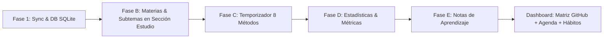
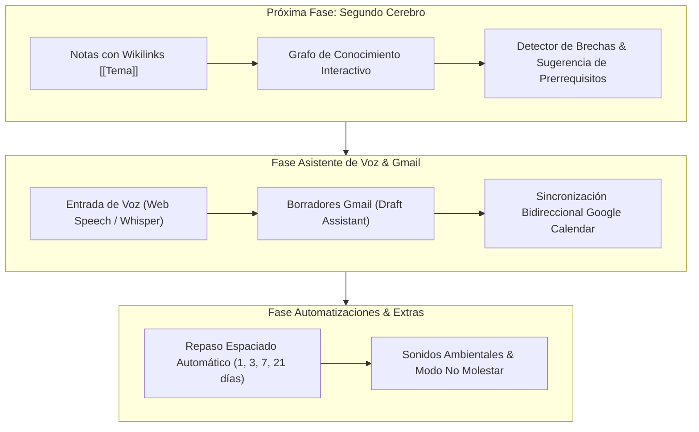

# 📜 Biblia de Lineamientos y Hoja de Ruta Oficial: Mi Diario

**Proyecto:** Mi Diario – Asistente Personal de Vida & Segundo Cerebro  
**Fecha de actualización:** 9 de Octubre, 2026  
**Estado del Sistema:** Producción Local Sincronizada • 107 registros activos • 100% Pruebas Pasadas (`npm test`)

---

## 🎯 1. Propósito Principal y Biblia de Lineamientos

La aplicación **Mi Diario** no es solo un gestor de tareas o un temporizador; es un **Asistente de Vida Personal e Integral y un Segundo Cerebro Interconectado**. Su misión principal es organizar, optimizar y potenciar la vida diaria del usuario en cuatro pilares fundamentales:

1. **Gestión de Vida y Tiempo Real**:
   - Organizar las rutinas diarias, hábitos y compromisos.
   - Mantener el control estricto de tareas ejecutadas, en progreso y vencidas.
   - Brindar un panel interactivo (Dashboard) donde cada acción diaria sea ejecutable y medible sin perder tiempo.

2. **Estudio Estratégico y Métodos de Enfoque**:
   - Medir y registrar el tiempo real dedicado **únicamente** a actividades de aprendizaje, desarrollo y proyectos de ingeniería/IA.
   - Aplicar técnicas comprobadas de enfoque (Pomodoro, Flowtime, Ultradiano, Deep Work) con captura de notas de aprendizaje y autoevaluación.

3. **Segundo Cerebro y Conexión de Conocimientos**:
   - Almacenar todo el conocimiento consumido (cursos, libros, documentación, ideas) permitiendo crear **enlaces bidireccionales (`[[Concepto]]`)**.
   - Visualizar redes de conocimiento (Grafo) para descubrir brechas técnicas y sugerir de forma inteligente las siguientes tecnologías o prerrequisitos a aprender.

4. **Asistente Ejecutivo de Voz y Automatización**:
   - Actuar como un asistente con dictado de voz para crear tareas, tomar notas y agendar eventos.
   - Conectarse a servicios externos (Gmail, Google Calendar) para preparar borrador de correos o coordinar reuniones **siempre solicitando confirmación del usuario antes de enviar**.

### 🛡️ Reglas Inquebrantables de Desarrollo (Biblia del Proyecto)

* **REGLA 1: Cero Pérdida de Datos**. Todos los cambios en la base de datos `agenda.db` deben ser atómicos, con soporte de tombstones y sincronización offline.
* **REGLA 2: Verificación verde obligatoria antes de cada commit**. Jamás se dará por completada una tarea sin ejecutar `npm test` y verificar que los 79 tests de backend, 33 de métricas/enfoque y 25 tests E2E de Playwright estén 100% en verde.
* **REGLA 3: Cero Invención de Funcionalidades No Solicitadas**. Ningún botón, módulo o sección se agregará o eliminará de las pantallas principales sin previo consentimiento explícito del usuario.
* **REGLA 4: Alcance Estricto del Enfoque**. El temporizador de enfoque se reserva **únicamente** para estudio/proyectos. Tareas de rutina personal (almuerzo, descanso, aseo) **jamás** llevan botones de enfoque.
* **REGLA 5: Diseño Profesional y Limpio (Taskly Amber/Black)**. Paleta elegante en tonos ambar/carbón, tipografía clara, alternador claro/oscuro fluido y **cero emojis informales** en la interfaz de producción.
* **REGLA 6: Estructura Inalterable del Dashboard (Agenda & Matriz de Actividades estilo GitHub)**.
  - El Dashboard es la **Agenda Central de Ejecución Diaria**.
  - **Matriz de Actividades y Ciclo Mensual (Estilo GitHub)**: Posicionada de forma principal en el Dashboard para visualizar las actividades realizadas y las no ejecutadas.
  - **Agenda de Hoy & Hábitos de Hoy**: Cronograma interactivo con checkboxes, banner de tareas pasadas sin registrar ("Mover a Mañana") y lista de hábitos del día.
  - **Exclusión de Materias en el Dashboard**: La sección "Mis Materias" pertenece **únicamente a la vista de Estudio**. El Dashboard es exclusivamente para agendar y ejecutar el día.
  - **Legibilidad Estricta en Modo Oscuro**: Toda cabecera, topbar y texto en modo oscuro debe tener contraste óptimo (evitando textos claros sobre fondos claros).

---

## 🛠️ 2. Estado de lo Construido (Fases Completadas y Verificadas)

Actualmente, el sistema cuenta con los siguientes cimientos y módulos completamente funcionales:

### 🟩 Fase 1: Arquitectura, Sincronización y Persistencia
- Base de datos SQLite (`backend/agenda.db`) con 107 filas activas resguardadas.
- Motor de sincronización multi-colección (*activities, subjects, topics, focus_sessions, learning_notes*).
- Resolución de conflictos mediante Rebase dinámico, propagación de tombstones y cola offline de cambios.

### 🟩 Fase B: Gestión de Materias y Subtemas (Sección Estudio)
- Sección de Estudio con materias (Inglés, GenAI, MLOps, Spark, etc.).
- Cálculo dinámico del porcentaje de dominio y horas semanales (0% y 0.0 h por defecto en nuevas materias).

### 🟩 Fase C: Motor de Enfoque Avanzado
- 8 Métodos de enfoque: Pomodoro (25:00), 50/10, 52/17, Ultradiano, Flowtime, Deep Work, Cronómetro y Personalizado.
- Detección y registro de ausencias/distracciones.
- Bloqueo entre pestañas (*multi-tab lock*) y recuperación automática de sesión tras recargar la página (F5).
- Botón de Enfoque restringido exclusivamente a actividades de estudio y proyectos.

### 🟩 Fase D: Estadísticas y Métricas Pure
- Visualizaciones por Día, Semana y Ciclo.
- Matriz Día × Hora, mapa de calor de intensidad mensual, racha de días consecutivos y tasa de cumplimiento.

### 🟩 Fase E: Notas de Aprendizaje (Learning Notes)
- Modal automático al finalizar la sesión de enfoque.
- Captura de temas vistos, qué aprendí (Markdown seguro), dudas, recursos y autoevaluación 1-5 (comprensión y concentración).
- Historial de notas con búsqueda, exportación a `.md` y generación automática de tareas de repaso.

### 🟩 Dashboard Interactivo y Corrección Visual
- **Matriz del Ciclo Mensual (Estilo GitHub Grid)**: Visualización estelar en la columna principal del Dashboard para trackear hábitos y ejecuciones diarias por categoría.
- **Hábitos de hoy**: Lista interactiva de hábitos del día integrados al Dashboard.
- **Agenda de Hoy**: Cronograma interactivo con checkboxes en tiempo real, detección de tareas pasadas sin registrar ("Mover a Mañana") y selector de días.
- **TopBar & Tema Oscuro Corregido**: Eliminación de contrastes deficientes en modo oscuro (cabeceras claras con texto claro neutralizadas).
- **Separación Limpia de Materias**: "Mis Materias" ubicadas exclusivamente en su apartado de Estudio.

---

## 🚀 3. Hoja de Ruta de lo Pendiente (Fases por Construir)

### 📝 Fase G: Segundo Cerebro (Second Brain & Knowledge Graph)
- **Notas Interconectadas (`[[Wikilinks]]`)**:
  - Vincular notas entre sí usando corchetes dobles (`[[Álgebra Lineal]]`, `[[PyTorch]]`).
  - Navegación bidireccional (*backlinks*) para ver relaciones entre aprendizajes.
- **Grafo de Conocimiento (Knowledge Graph UI)**:
  - Vista interactiva de nodos para explorar la red visual de conocimientos.
- **Detector de Brechas Tecnológicas**:
  - Sugerencia de tecnologías o prerrequisitos recomendados por aprender.

### 🎙️ Fase H: Agente de Voz & Asistente Ejecutivo (Gmail / Calendario)
- **Dictado e Instrucciones por Voz**:
  - Micrófono integrado para agendar tareas y tomar notas en voz alta.
- **Integración Gmail Drafts**:
  - Redacción automática de borradores de correo mediante dictado de voz, listos para tu aprobación previa.
- **Google Calendar Sync**:
  - Sincronización bidireccional de eventos y reuniones externas.

### ⚡ Fase F: Extras de Enfoque y Repaso Espaciado
- **Repaso Espaciado Programado**: Notificaciones a los 1, 3, 7 y 21 días.
- **Sonidos Ambientales**: Reproductor de sonido lo-fi/lluvia integrado al temporizador.
